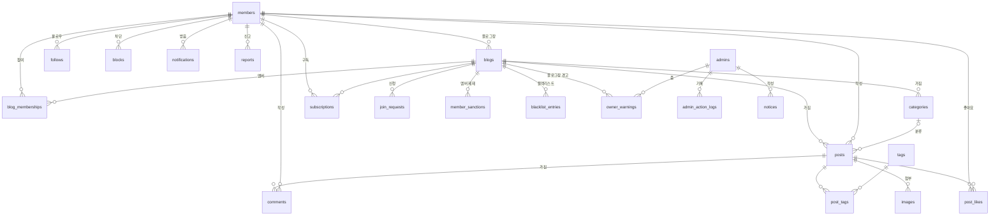
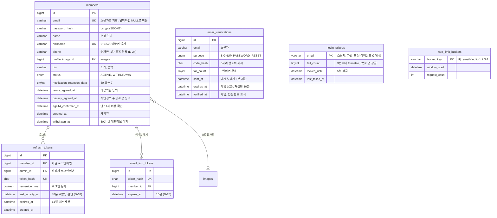
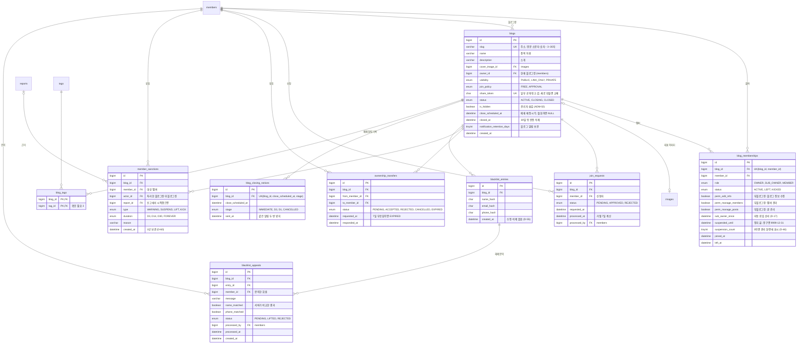
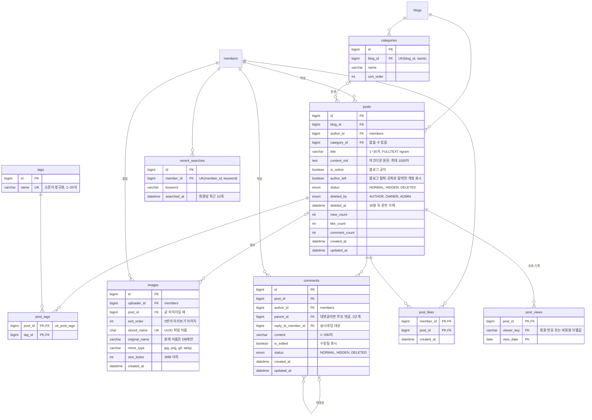
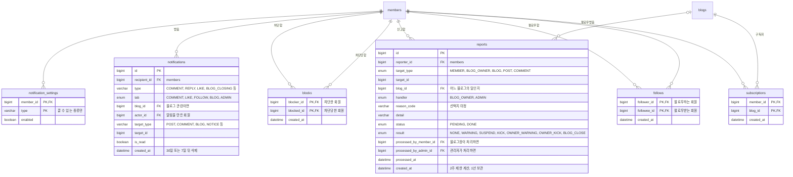
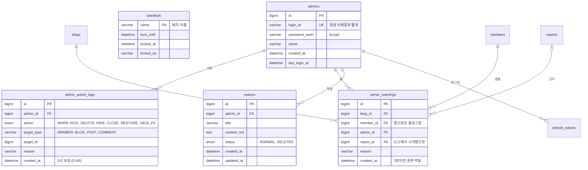

# ERD (데이터베이스 설계 초안)

`specs/001~005`와 [헌법](../../.specify/memory/constitution.md)을 바탕으로 그린 전체 테이블 설계 초안입니다. 기능별 `/speckit-plan`에서 `data-model.md`를 만들 때 이 문서에서 출발하고, 바뀐 내용은 여기에도 반영합니다 (D-47).

- DB: MySQL 8 (InnoDB, utf8mb4). 모든 시각은 `datetime`이며 Asia/Seoul 기준으로 다룹니다.
- 표기: `PK` 기본키, `FK` 외래키, `UK` 고유. 선 끝의 `||`는 "정확히 하나", `o|`는 "없거나 하나", `o{`는 "없거나 여러 개"입니다.
- 그림이 크지 않도록 전체 지도 하나와 영역별 그림 다섯 개로 나눴습니다. 다른 영역의 테이블은 이름만 있는 빈 상자로 보입니다.

## 전체 지도

테이블 사이의 관계만 보여줍니다. 칼럼은 아래 영역별 그림에 있습니다.

## 1. 회원·인증 (001, USR·SEC)

| 테이블 | 하는 일 | 근거 |
|---|---|---|
| `members` | 회원 계정. 탈퇴해도 행은 남겨 글의 작성자 연결을 유지하고, 개인정보 칸만 30일 뒤 비움 | USR-01·05·07, 4.5, 4.6 |
| `email_verifications` | 가입·비밀번호 재설정 인증번호. 쓰거나 만료되면 바로 삭제 | USR-02·06, SEC-05 |
| `email_find_tokens` | 이메일 찾기 결과에서 [비밀번호 재설정]을 누를 때 쓰는 10분짜리 임시 토큰 | USR-08, D-26 |
| `refresh_tokens` | 로그아웃·비밀번호 변경 때 폐기할 수 있게 DB에 저장 | SEC-04, D-53 |
| `login_failures` | 계정별 잠금과 Turnstile 표시 기준 | SEC-03, SEC-13, D-79, D-80 |
| `rate_limit_buckets` | IP별 요청 제한 횟수 | D-80, SCL-01 (아래 확인 필요 1) |

## 2. 블로그·멤버 (002, BLG)

| 테이블 | 하는 일 | 근거 |
|---|---|---|
| `blogs` | 블로그. 주소는 폐쇄 30일 뒤 행을 지우면서 다시 쓸 수 있게 됨 | BLG-01·09, D-35, D-49 |
| `blog_memberships` | 회원 × 블로그의 역할, 부블로그장 권한, 정지 상태 | BLG-13, SEC-07, D-71 |
| `join_requests` | 참여 신청. 대기 중 재신청 금지, 거절 7일 계산 | BLG-04·05 |
| `ownership_transfers` | 블로그장 위임 요청 | BLG-08, D-16, D-31 |
| `member_sanctions` | 블로그 안 멤버 경고·정지·해제·강제 퇴장 기록 | BLG-13, D-57 |
| `blacklist_entries` | 강제 퇴장한 사람의 이름·이메일·전화번호 해시 | BLG-11, D-34 |
| `blacklist_appeals` | 블랙리스트 해제 문의 | BLG-12 |
| `blog_closing_notices` | 폐쇄 알림을 단계별로 보냈는지 기록. 배치가 밀려도 중복 발송 안 함 | BLG-09, 7장 폐쇄 처리 |
| `blog_tags` | 블로그에 단 태그 (확인 필요 3) | BLG-03 |

## 3. 게시판 (004, BRD)

| 테이블 | 하는 일 | 근거 |
|---|---|---|
| `posts` | 글. 본문은 마크다운으로만 저장하고 보여줄 때 HTML로 바꿔 jsoup으로 거름 | BRD-01, SEC-06, D-66 |
| `categories` | 블로그별 카테고리 | BRD-03 |
| `tags`, `post_tags` | 태그와 글 연결. 한 글 안의 같은 태그는 PK로 막음 | BRD-04, 6.4 |
| `images` | 글 이미지, 프로필 사진, 블로그 대표 이미지를 한 테이블에 | BRD-05, SEC-08, D-75 |
| `comments` | 댓글·대댓글. 답글이 있는 댓글을 지우면 `DELETED`로 두고 "삭제된 댓글입니다" 표시 | BRD-06, D-78 |
| `post_likes` | 좋아요. 다시 누르면 행을 지움 | BRD-06 |
| `post_views` | 같은 사람·같은 날·같은 글은 한 번만 | BRD-11, D-77 |
| `recent_searches` | 본인의 최근 검색어 | BRD-08, 6.1 |

검색용 인덱스: `blogs(name, description)`과 `posts(title)`에 `FULLTEXT ... WITH PARSER ngram`, `tags.name`과 `members.nickname`은 일반 인덱스로 일치 검색 (BRD-08).

## 4. 소셜·알림·신고 (003, SOC)

| 테이블 | 하는 일 | 근거 |
|---|---|---|
| `follows`, `subscriptions` | 회원 팔로우, 블로그 구독. 다시 누르면 행을 지움 | SOC-01, D-02 |
| `blocks` | 회원 차단. 차단할 때 서로의 `follows`를 지움 | SOC-05, D-36 |
| `reports` | 신고. 블로그 안 대상은 블로그장, 블로그·블로그장은 관리자에게 | SOC-06, D-45 |
| `notifications` | 알림. 30초 폴링으로 안 읽은 것을 셈 | SOC-04, D-72 |
| `notification_settings` | 끌 수 있는 알림만 행을 둠. 행이 없으면 켜짐 | SOC-04, D-56 |

## 5. 관리자·운영 (005, ADM)

| 테이블 | 하는 일 | 근거 |
|---|---|---|
| `admins` | 일반 회원과 분리한 관리자 계정 | SEC-09 (아래 확인 필요 2) |
| `admin_action_logs` | 관리자의 조치와 개인정보 "전체 보기" 기록 | ADM-06, SEC-09 |
| `owner_warnings` | 블로그장 경고. 블로그별로 세어 3번이면 권한 박탈 | ADM-07, D-30 |
| `notices` | 메인 공지사항 | BRD-10 |
| `shedlock` | 여러 서버에서 04:00 배치가 한 번만 돌게 하는 잠금 (ShedLock 기본 테이블) | SCL-03 |

## 설계하며 정한 것

문서에 없거나 여러 방식이 가능한 곳은 아래처럼 정했습니다. 다르게 하고 싶으면 이 목록에서 고치면 됩니다.

1. **블로그장은 `blogs.owner_id`와 `blog_memberships.role = OWNER` 두 곳에 둡니다.** `owner_id`는 생성 개수 세기(D-68)와 "내가 만든 블로그"를 빠르게 찾기 위해, 멤버십의 OWNER는 권한 확인을 한 가지 방식으로 하기 위해서입니다. 위임할 때 두 곳을 한 트랜잭션에서 바꿉니다.
2. **부블로그장 권한은 체크박스 3개**(정보 수정, 멤버 관리, 글 관리)로 멤버십 행에 둡니다. 역할·권한 표(002)에서 "맡길 수 있음"인 항목을 묶은 것이고, 참여 승인·신고 처리·블랙리스트 문의는 "멤버 관리"에 포함했습니다.
3. **정지는 멤버십의 `suspended_until` 하나로 봅니다.** 영구 정지는 `9999-12-31`로 넣고, 정지 이력은 `member_sanctions`에 따로 남깁니다.
4. **블로그를 떠난 멤버의 글**은 `posts.author_left`로 "탈퇴한 계정"을 표시합니다 (D-33). 멤버십 상태로만 판단하면 다시 참여했을 때 예전 글이 되살아나기 때문입니다. 사이트 탈퇴는 `members.status = WITHDRAWN`으로 "탈퇴한 회원"을 표시합니다.
5. **탈퇴한 회원의 행은 지우지 않습니다.** 이메일은 즉시 NULL로 비워 같은 이메일로 다시 가입할 수 있게 하고(MySQL 고유 인덱스는 NULL을 여러 개 허용), 이름·전화번호 등은 30일 뒤 배치가 비웁니다.
6. **인증번호·로그인 실패·요청 제한 테이블은 회원과 연결하지 않고 이메일·IP로 찾습니다.** 가입 안 된 이메일도 똑같이 다뤄야 가입 여부가 드러나지 않습니다 (D-28).
7. **블랙리스트 해시**는 서버 비밀값을 섞은 HMAC-SHA256으로 합니다. 전화번호는 경우의 수가 적어 일반 해시는 쉽게 되돌릴 수 있기 때문입니다. 비교 전 이메일은 소문자, 전화번호는 숫자만, 이름은 앞뒤 공백을 지웁니다.
8. **이미지는 한 테이블**에 모으고, 글 이미지는 글을 저장하기 전에 올라오므로 `post_id`를 비워 두었다가 저장할 때 연결합니다. 연결되지 않은 채 하루가 지난 이미지는 04:00 배치가 지웁니다.
9. **좋아요·조회수·댓글 수는 `posts`에 숫자로도 둡니다.** 목록과 인기 정렬이 1초 안에 나와야 해서(D-48) 매번 세지 않습니다. 원본 기록은 `post_likes`, `post_views`, `comments`입니다.
10. **메인 공지사항은 `notices`로 따로 둡니다.** 관리자 계정을 회원과 분리했기 때문에(SEC-09) 회원 글 테이블인 `posts`에 넣지 않았습니다. 블로그 공지는 `posts.is_notice`입니다.
11. **공지 알림은 전체 회원에게 한 줄씩** `notifications`에 넣습니다. 1차 규모에서는 이 방식이 가장 단순합니다.
12. **관리자도 `refresh_tokens`를 같이 씁니다.** `member_id`와 `admin_id` 중 하나만 채웁니다.
13. **폐쇄 알림 중복 방지**는 알림 테이블이 아니라 `blog_closing_notices`로 합니다. 회원이 알림을 지워도 다시 보내지 않게 하기 위해서입니다.
14. **신고 대상은 `target_type + target_id`로 둡니다.** 대상이 네 종류라 외래키를 걸지 않고, 블로그 안의 일이면 `blog_id`로 접수처를 찾습니다.

## 확인이 필요한 것 (설계에 영향을 주는 남은 질문)

[specs/README.md](../../specs/README.md)의 "확인이 필요한 항목" 중 테이블 모양이 달라지는 것만 모았습니다. 정해지면 이 문서와 해당 spec을 함께 고칩니다.

| 번호 | 질문 | 지금 그린 방식 | 다르게 정하면 |
|---|---|---|---|
| 1 | IP별 요청 제한을 서버 메모리에서 셀지 DB에서 셀지 (SCL-01과 4.3이 어긋남) | SCL-01을 따라 DB `rate_limit_buckets` | 메모리로 정하면 이 테이블을 뺌 |
| 2 | 관리자가 회원 활동(블로그 생성·글쓰기·팔로우)도 하는지 (SEC-09와 2장 권한 표가 어긋남) | 관리자 계정을 `admins`로 완전히 분리. 회원 활동이 필요하면 관리자가 회원 계정을 따로 씀 | 같은 계정으로 하면 `admins` 대신 `members.is_admin` 같은 칸 하나 |
| 3 | 블로그 태그를 직접 다는지, 글 태그로 찾는지 (BLG-03) | 블로그에 직접 다는 `blog_tags`를 그려 둠 | 글 태그로 찾으면 `blog_tags`를 빼고 `post_tags`를 블로그별로 모음 |
| 4 | 스스로 탈퇴한 멤버의 재참여 | 같은 멤버십 행을 `ACTIVE`로 되돌림 (블로그·회원 쌍은 하나) | 재참여 대기 기간을 두면 `left_at`으로 계산 |
| 5 | 비회원 조회수의 "같은 사람" 기준 | `viewer_key` 문자열 하나로 받아 회원 번호든 비회원 값이든 넣음 | IP와 쿠키를 함께 쓰면 칸을 나눔 |
| 6 | 블로그 숨김의 동작, 강제 폐쇄가 즉시인지 | `blogs.is_hidden` 칸 하나, 폐쇄는 `status`·`close_scheduled_at`을 그대로 씀 | 숨김 사유·기간이 필요하면 칸 추가 |
| 7 | 신고 사유 선택지 | `reason_code` 문자열 | 선택지가 정해지면 enum으로 |
| 8 | "인기" 기준 (블로그 목록, 피드, 검색) | `posts`의 좋아요·조회수 숫자로 계산할 수 있게만 해 둠 | 구독자 수 기준이면 `blogs`에 구독자 수 칸 추가 |

## 그리지 않은 것

- 로그인 IP·브라우저 기록(4.6 자동 수집): 보관 기간과 용도가 문서에 없어 테이블을 만들지 않았습니다.
- 개별 블로그 꾸미기(테마·메뉴), 문자 인증, 서버 임시저장: 1차 범위 밖입니다 (헌법 VIII).
